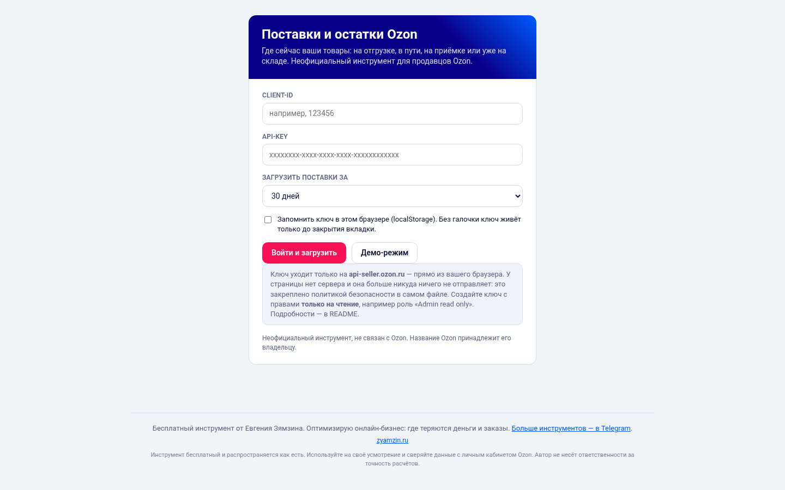
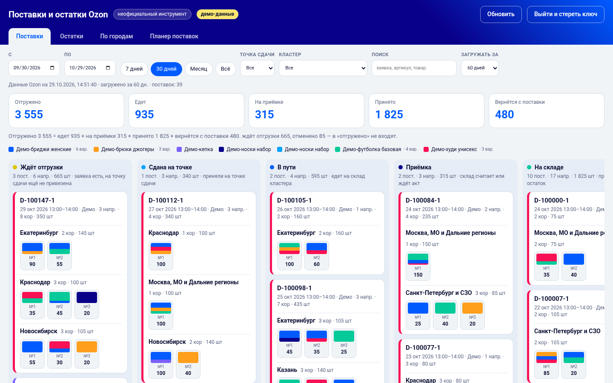
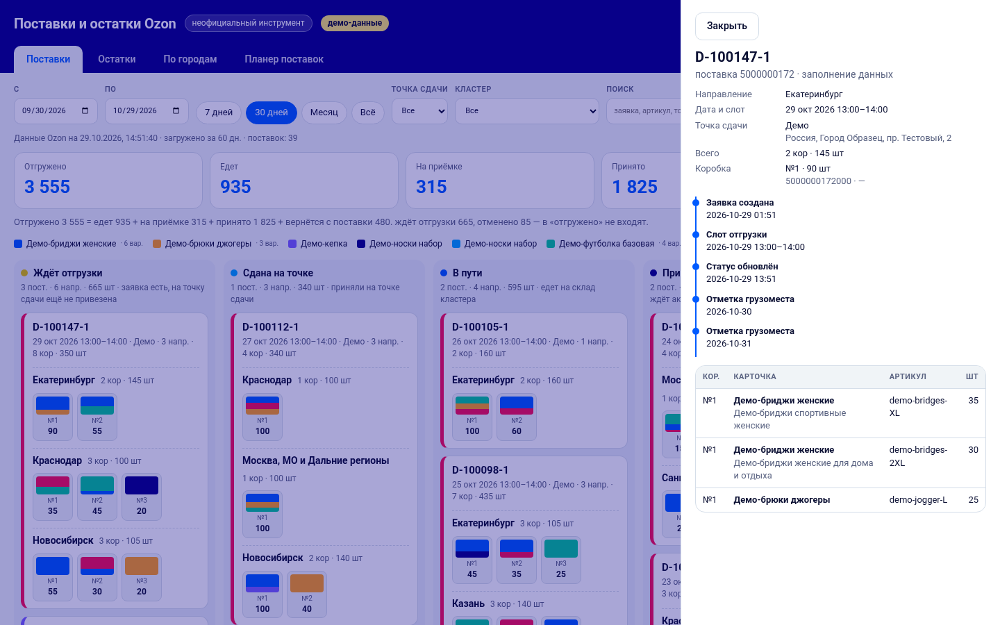
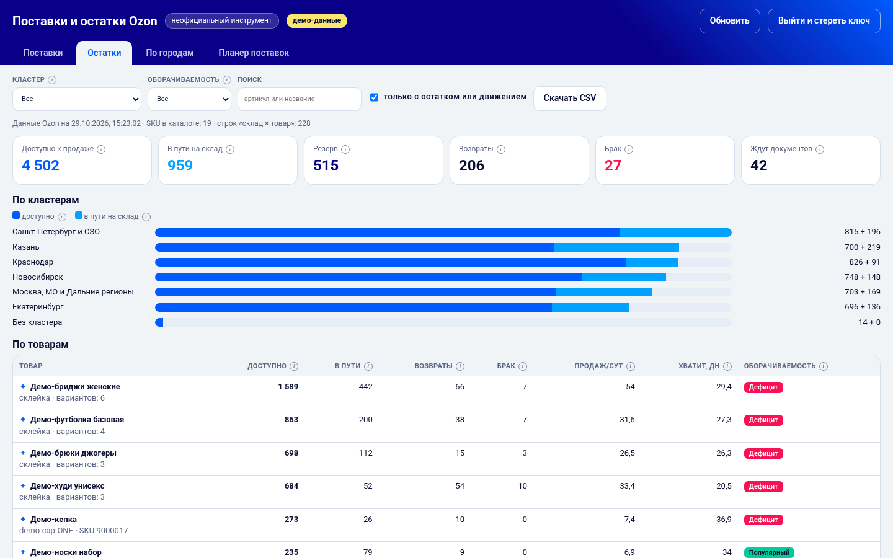
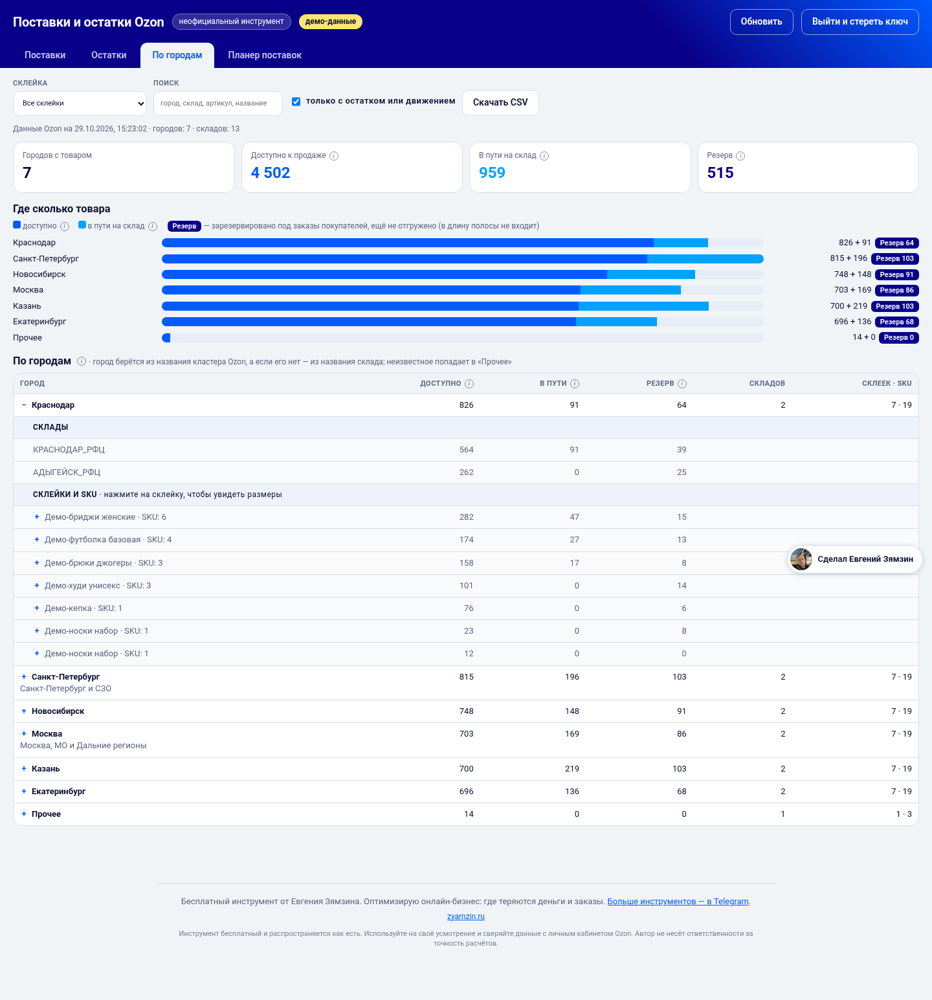
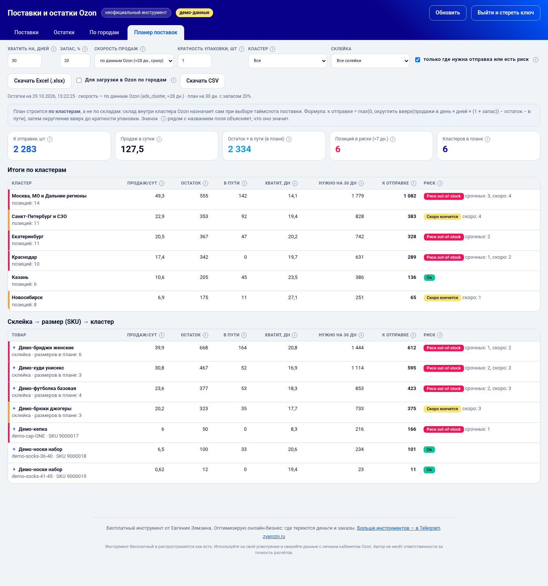

# Поставки и остатки Ozon

Один HTML-файл, который показывает продавцу Ozon, **где сейчас его товар**: что ждёт отгрузки, что едет на склады, что на приёмке и что уже принято, плюс остатки по кластерам и товарам.

Никакого сервера, установки и регистрации. Скачали файл, открыли в браузере, ввели свой ключ Ozon — готово.

> ⚠️ **Неофициальный инструмент.** Он не связан с Ozon и не одобрен Ozon. Название и цвета Ozon принадлежат их владельцу. Инструмент работает через открытый Seller API и ничего не меняет в вашем кабинете: только чтение.

## Скриншоты

Все скриншоты сделаны в демо-режиме, реальных данных на них нет.

**Вход: вставляете Client-Id и API-ключ (или открываете демо)**

**Поставки: где сейчас каждая поставка**

**Карточка поставки: состав и путь по этапам**

**Остатки по товарам и кластерам**

**По городам: сколько товара в каждом кластере**

**Планер поставок: сколько и куда отправить**

## Что внутри

**Вкладка «Поставки»**
- канбан из шести этапов: ждёт отгрузки → сдана на точке → в пути → приёмка → на складе → возвраты и отмены;
- плитки-счётчики («Отгружено = едет + на приёмке + принято + вернётся с поставки») — по клику фильтруют доску;
- фильтры по датам, точке сдачи, кластеру, поиск по заявке, артикулу и названию товара;
- карточка поставки: хронология, грузоместа, содержимое коробок, акты приёмки и возврата;
- по каждому направлению видно, сколько штук в каких коробках;
- **склейки** определяются как в Ozon: по `model_id` («Объединить на одной карточке»), а не по названию. Бриджи 8 размеров с тремя разными SEO-названиями — это одна склейка; общее название — общая часть названий или самое частое. Товары без `model_id` показываются поштучно.

**Вкладка «Остатки»**
- возле неочевидных полей и колонок есть значок ⓘ: на компьютере подсказка открывается по наведению, на телефоне по нажатию; в подсказках — смысл поля и формула;
- доступно к продаже, в пути на склад, резерв (отдельный значок «Резерв N»: зарезервировано под заказы покупателей, ещё не отгружено), возвраты, брак;
- столбики по кластерам, таблица по товарам с раскрытием по складам;
- оборачиваемость и «хватит, дн.»;
- остатки сгруппированы по склейкам (раскрытие: кластеры → размеры);
- выгрузка в CSV.

**Вкладка «По городам»**
- сколько товара сейчас в каждом городе/кластере: доступно, в пути, резерв; сортировка по объёму, столбчатая диаграмма;
- раскрытие до складов и до склеек → размеров (SKU);
- город берётся из названия кластера Ozon («Москва, МО и Дальние регионы» → Москва), если кластера нет — из названия склада; неизвестное попадает в «Прочее»;
- выгрузка в CSV.

**Вкладка «Планер поставок»**
- для каждой склейки → размера (SKU) → кластера: продажи в день, остаток, в пути, «хватит, дн.» и рекомендация к отправке;
- рекомендация = `max(0, ceil(продажи/сут × N дней × (1 + запас)) − остаток − в пути)`, при желании округляется вверх до кратности упаковки;
- параметры: на сколько дней (по умолчанию 30), запас % (20), источник скорости продаж, кратность, фильтры по кластеру и склейке;
- итоги по кластерам, подсветка риска out-of-stock (меньше 7 дней — красный, меньше 14 — жёлтый);
- источник скорости: «по данным Ozon» (поле `ads_cluster` из аналитики остатков, примерно за 28 дней, мгновенно) или «за 30/60 дней по отправлениям» (считается по FBO-отправлениям без отмен и кластеру отгрузки; загрузка 60 дней — около минуты);
- выгрузка в **Excel (.xlsx)** и CSV (`;`, UTF-8 с BOM). Excel собирается прямо в браузере, без внешних библиотек;
- галочка **«Для загрузки в Ozon по городам»** рядом с кнопкой Excel: вместо одного файла скачивается один **zip**:
  - по одному `.xlsx` на каждый кластер, имя файла = название кластера (недопустимые в именах символы заменяются пробелом);
  - формат повторяет шаблон Ozon для загрузки товаров в поставку: лист `Sheet1`, заголовки `артикул` / `имя (необязательно)` / `количество`, артикул (`offer_id`) — текст, колонка «имя (необязательно)» остаётся только заголовком (значения пустые), количество — целое число; шрифт, ширина столбца B и высота строк как в шаблоне;
  - в файл попадают только строки с количеством больше 0; учитываются текущие фильтры (кластер, склейка, «только где нужна отправка») и кратность упаковки;
  - в zip также лежит `Сводный отчёт.xlsx` — «План поставок», «Параметры» и по листу на каждый кластер.

  Файлы формируются локально в браузере и ничего не отправляются в Ozon: проверьте их и загрузите сами. Если Ozon изменит шаблон, сверьте заголовки.
- **план строится по кластерам, а не по складам**: конкретный склад внутри кластера Ozon назначает сам при выборе таймслота поставки.

**Демо-режим** — кнопка «Демо-режим» на входе (или `index.html#demo`). Выдуманные данные, ключ не нужен: удобно посмотреть, как это выглядит.

## Как скачать и открыть

1. Скачайте файл [`index.html`](index.html) (на GitHub: открыть файл → кнопка *Download raw file*; или *Code → Download ZIP* и распакуйте).
2. Дважды щёлкните по нему — он откроется в браузере (Chrome, Edge, Firefox, Safari). Интернет нужен только для запросов к Ozon.
3. Введите **Client-Id** и **Api-Key**, нажмите «Войти и загрузить».

Файл можно держать на рабочем столе, в облаке или раздать коллегам. Каждый вводит свой ключ.

## Как получить ключ (только чтение)

1. Личный кабинет продавца Ozon → **Настройки → Seller API**.
2. Нажмите **«Сгенерировать ключ»**.
3. Название — любое, например «Доска поставок».
4. Роль: **Admin read only**. Либо минимальный набор только на чтение: *Supply order ReadOnly*, *Product Read Only*, *Report*/*Analytics* (остатки), *Posting FBO Read Only* (для планера по отправлениям).
5. Ограничение по IP не нужно.
6. Скопируйте ключ — Ozon показывает его **один раз**. Client-Id виден на той же странице.

Не давайте инструменту ключ с правами записи: ему они не нужны.

## Безопасность

- Ключ отправляется **только** на `https://api-seller.ozon.ru` — напрямую из вашего браузера. Это закреплено политикой безопасности (CSP) в самом файле: страница технически не может послать данные на другой адрес. В файле нет внешних скриптов, шрифтов, аналитики и CDN.
- По умолчанию ключ хранится в `sessionStorage` и исчезает при закрытии вкладки. В `localStorage` (между сессиями) он попадает **только если вы поставили галочку «Запомнить ключ в этом браузере»**.
- Кнопка **«Выйти и стереть ключ»** удаляет ключ из обоих хранилищ.
- Не ставьте галочку «Запомнить» на чужом или общем компьютере.
- Если ключ мог попасть не туда, отзовите его в кабинете (Seller API) и создайте новый.
- Исходный код — один читаемый файл, можно проверить глазами.

## Ограничения

- **Лимиты Ozon.** Запросы идут с паузами и повторяются при ответе 429. Первая загрузка может занять от десяти секунд до минуты; сообщения о повторах во время загрузки — это нормально.
- **Акты по товарам** (подробные строки приёмки) Ozon отдаёт примерно раз в минуту, поэтому они подгружаются по требованию, а не сразу.
- Распределение по этапам канбана выведено из статусов поставки Ozon; если Ozon добавит новые статусы, неизвестный статус попадёт в колонку «Ждёт отгрузки».
- Названия кластеров и точек сдачи упрощаются автоматически (убираются служебные приставки), поэтому могут слегка отличаться от кабинета.
- Подписи некоторых полей остатков (например, «Резерв») — наша интерпретация полей аналитики Ozon.
- Окно загрузки по умолчанию 30 дней (до года). Поставки в активных статусах загружаются независимо от возраста.
- Склейки берутся из `model_info.model_id` карточек; если каталог не загрузился, инструмент покажет предупреждение и сгруппирует товары по SKU.
- Планер: пара «размер × кластер» без остатка и без продаж в нём не показывается; «в пути» берётся из аналитики Ozon на момент загрузки; скорость — оценка, не прогноз (сезонность, акции и рост не учитываются).
- Возвраты от покупателей не показываются — только возвраты и отклонения по поставкам.
- API Ozon меняется. Если что-то перестало работать — проверьте, что ключ действителен и есть нужные права; сообщение об ошибке на странице подскажет, какой метод не ответил.

## Что запрашивается

Все запросы — `POST` на `api-seller.ozon.ru`: `/v2/cluster/list`, `/v3/supply-order/list`, `/v3/supply-order/get`, `/v1/supply-order/bundle`, `/v1/cargoes/get`, `/v1/supply-order/act/summary/get`, `/v1/supply-order/act/product/get`, `/v3/product/list`, `/v3/product/info/list` (склейки), `/v1/analytics/stocks`, `/v3/posting/fbo/list` (только в планере и только если выбран источник «по отправлениям»). Ни один из них ничего не изменяет.

## Дисклеймер

Инструмент бесплатный и распространяется как есть. Используйте на своё усмотрение и сверяйте данные с личным кабинетом Ozon. Автор не несёт ответственности за точность расчётов.

## Автор

Инструмент бесплатный, его сделал **Евгений Зямзин** — оптимизирую онлайн-бизнес: ищу, где теряются деньги и заказы.

- Telegram-канал: <https://t.me/evgenyzyamzin>
- Сайт: [zyamzin.ru](https://zyamzin.ru/?utm_source=github&utm_medium=readme&utm_campaign=ozon_stock)

В самом инструменте есть небольшой «блок автора»: бейдж справа внизу, подвал и один раз показываемое окно после первой успешной загрузки (его можно закрыть крестиком или Esc; больше оно не появится). Блок вынесен в отдельный переиспользуемый компонент `author-block` и ничего не отправляет: это только ссылки, никакой аналитики и сетевых запросов.

## Лицензия

MIT — см. [LICENSE](LICENSE). Автор: Евгений Зямзин. Делитесь, дорабатывайте, ставьте ссылку на источник — будет приятно.
